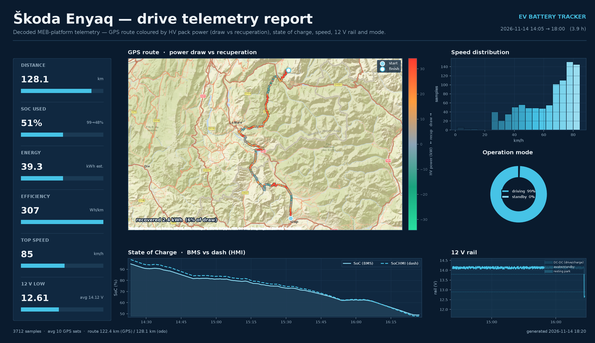
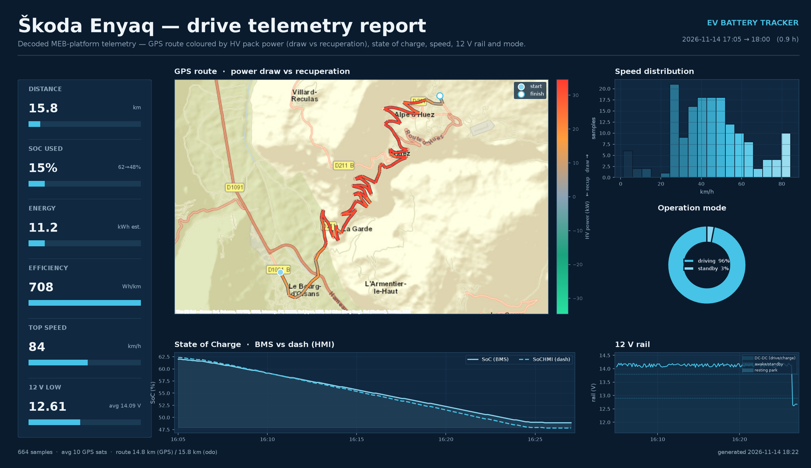

# EV Battery Tracker

[](https://github.com/abroooo/mebtap/actions/workflows/ci.yml)

Telemetry logger for _**VW MEB platform**_ (for example VW ID.3/4/5/6, Skoda Enyaq).
An ESP32 on the car's OBD-II port polls the vehicle over CAN/UDS, buffers samples
on flash, and forwards them to a Rust backend for storage and analysis: State of
Charge, SoH trend, pack voltage/current, cell voltages, temperatures, and GPS
straight from the car.

> Status: host stack complete and tested in CI. Firmware validated on the real car.
> The full collect → decode → store → uplink pipeline is built as host-testable
> std Rust - cargo clippy -D warnings + cargo test --workspace run on every
> push (GitHub Actions), including backend integration tests against a real
> TimescaleDB (testcontainers). The same collector now runs on the ESP32 on the
> car's (Skoda Enyaq) OBD-II port: parked bring-up confirms live UDS polling (SoC,
> pack V/I, temps, GPS-from-car) over the real 500 kbit/s bus. Parked-mode firmware
> hardening (power management + store-and-forward uplink) is in final cleanup.

---

## Why this design

**Firmware is just glue. All logic lives in host-testable crates behind traits.**

The ESP32 only supplies concrete implementations (TWAI, flash, WiFi). Everything
that matters, the UDS/ISO-TP client, the lane scheduler, the discovery stats,
the sample schema, is plain `std` Rust that compiles and runs on a pc. A
host simulator (`ecu-sim`) runs the _exact_ collector code the ESP32 runs, against
an in-memory mock MEB ECU. So the real system could be built and validated
before the real transceiver was even in hand.

```
      ┌──────────────┐        CAN / UDS 0x22         ┌──────────────┐
      │   VW MEB     │  ◄───────────────────────────►│    ESP32     │
      │   vehicle    │     (listen-only until poll)  │  (thin glue) │
      └──────────────┘                               └──────┬───────┘
                                                            │ batch POST
         swap in for the real car on the host               ▼
      ┌──────────────┐        same collector code     ┌──────────────┐
      │   ecu-sim    │  ◄───────────────────────────► │   backend    │
      │ (mock ECU)   │                                │ axum + TSDB  │
      └──────────────┘                                └──────────────┘
```

## Workspace layout

```
crates/
  meb-proto/   DID catalogue, per-signal decoders, Sample schema (serde).
  collector/   Transport traits + UDS/ISO-TP client + lane scheduler + stats.
  ecu-sim/     In-memory mock MEB ECU; runs collector end-to-end on the host.
backend/       axum ingest + TimescaleDB query API (sqlx).
firmware/      ESP32 (esp-idf-hal, std) glue. SEPARATE crate, own esp toolchain.
docs/          architecture.md, mvp-spec.md, meb-can-pids.md (authoritative).
```

`firmware/` is **excluded from the host workspace** so the Xtensa (esp) toolchain
and the x86 stable toolchain never collide. It reuses `meb-proto` + `collector`
by path dependency: same logic, different concrete drivers.

### The crates

| Crate           | What it does                                                                                                                                                                                                                                                                                                  |
| --------------- | ------------------------------------------------------------------------------------------------------------------------------------------------------------------------------------------------------------------------------------------------------------------------------------------------------------- |
| **`meb-proto`** | Single source of truth for the wire format. DID catalogue (SoC, Speed, PackV/I, GPS, temps, cell voltages, odometer, max-energy/SoH, DC-DC, 12 V…), per-signal scaling, and the `Sample`/`SampleBatch` serde schema shared by firmware, sim, and backend.                                                     |
| **`collector`** | Pure logic, no ESP/host deps. Defines the seams as traits: `CanBus`, `SampleStore`, `Uplink`, plus a UDS service-`0x22` client with ISO-TP single/multi-frame + flow control, a fast/slow `LaneScheduler`, and `DidStats` (response rate, latency, multi-frame flag, effective update rate, full-pass timer). |
| **`ecu-sim`**   | `MemCanBus` (paired in-memory channels) + `MebEcuSim` answering canned UDS responses, including a flow-controlled multi-frame GPS reply and configurable non-responders. Binary prints the live discovery table and can POST to the backend.                                                                  |
| **`backend`**   | `axum` ingest + TimescaleDB hypertables via `sqlx`. Device-key auth. Query API for DIDs / latest / time series. Uses runtime queries so `cargo check` works without a live DB.                                                                                                                                |
| **`firmware`**  | ESP32 drivers: `TwaiCanBus` (TWAI, 500 kbit/s), `FlashStore` (LittleFS), `WifiUplink` (TLS batch POST). `main` wires them into `collector`. The only non-host-tested code.                                                                                                                                    |

## Quick start

```sh
# Host simulator - collector ↔ mock MEB ECU, prints the discovery table.
cargo run -p ecu-sim

# Full host stack, end to end: sim → backend → query.
docker-compose up -d                                          # TimescaleDB, host :5433
DATABASE_URL=postgres://ev:ev@localhost:5433/ev_tracker \
  DEVICE_KEY=dev cargo run -p backend &                       # API on :3000 (runs migrations)
cargo run -p ecu-sim -- --uplink http://localhost:3000 --device-key dev
curl 'http://localhost:3000/latest'
```

```sh
cargo test --workspace     # meb-proto + collector + ecu-sim + backend
```

### Backend API

| Method | Path                     | Notes                                                     |
| ------ | ------------------------ | --------------------------------------------------------- |
| `GET`  | `/health`                | liveness                                                  |
| `POST` | `/ingest`                | body = `SampleBatch` JSON; header `x-device-key` required |
| `GET`  | `/dids`                  | distinct DIDs seen                                        |
| `GET`  | `/latest`                | latest value per DID                                      |
| `GET`  | `/series?did=&from=&to=` | time range (RFC3339)                                      |

Env: `DATABASE_URL` (compose publishes TimescaleDB on host **:5433** →
`postgres://ev:ev@localhost:5433/ev_tracker`; code default is `:5432`),
`DEVICE_KEY` (default `dev`), `BIND` (default `0.0.0.0:3000`).

### Firmware (bench build only)

Needs the esp toolchain + ESP-IDF, so it's **excluded from the host workspace and
not built in CI** - the Xtensa toolchain is kept off the stable x86 path. Built on
the bench; see [`firmware/README.md`](firmware/README.md).

```sh
. "$HOME/export-esp.sh"
cd firmware
WIFI_SSID=... WIFI_PASS=... BACKEND_URL=http://<host>:3000 DEVICE_KEY=dev \
  cargo build --release
```

## What you can do with the data

One example, a drive telemetry poster: the GPS route coloured by **HV pack power
(draw vs recuperation)**, state-of-charge, speed, operating mode, and the 12 V rail.





Rendered from synthesized drive data (physics-based, same schema as the real
feed) - generator + renderer in [`scripts/demo-poster.sh`](scripts/demo-poster.sh).

## How the car actually talks

- **500 kbit/s CAN.** The OBD port is **gateway-firewalled**. This means powertrain frames
  are _not_ free-broadcast. Data comes from **UDS polling** (service `0x22`
  ReadDataByIdentifier + DID), not passive sniffing.
- **Mixed addressing:** `17FCxxxx` = 29-bit headers (BMS/DCDC/Drivetrain),
  `7xx` = 11-bit (Online/Climate/Energy). The collector handles both.
- **Multi-frame (ISO-TP + flow control)** for GPS, cell voltages, 12 V.
- **Two lanes:** fast (~1 Hz: SoC, speed, pack V/I, GPS) and slow (~20–30 s:
  temps, 76 cell voltages, odometer, SoH, DC-DC), switched by the drive-mode DID.
- OBD-port power never dies

## Safety

The firmware is **read-only by construction**:

- Only UDS service **`0x22`** (ReadDataByIdentifier) is exposed. There is
  deliberately _no_ API for session-control, routine, actuator, or write
  services (enforced in `collector`, not just by convention).
- The bus starts **listen-only** and only transmits while a poll is in flight.
- Sane poll cadence; never keeps the gateway awake while parked.

## Docs

- [`docs/architecture.md`](docs/architecture.md) - authoritative system design.
- [`docs/mvp-spec.md`](docs/mvp-spec.md) - discovery-phase goals + acceptance.
- [`docs/meb-can-pids.md`](docs/meb-can-pids.md) - PID/header map + CAN shield notes.

## TODO

- [ ] update [[meb-can-pids]], csv is truth

## Roadmap

**Done**

- [x] Host pipeline: UDS/ISO-TP client, lane scheduler, discovery stats, serde schema: unit-tested end-to-end against the mock ECU (`ecu-sim`).
- [x] Backend: axum ingest + TimescaleDB query API, idempotent ingest, migrations on startup.
- [x] On-car bring-up: firmware flashed to the ESP32 + CAN shield; UDS polling validated against the live car (parked), DIDs confirmed, GPS/UTC decoded from the car.

**In progress**

- [ ] Land the full data-driven DID catalogue + `GpsPosition`/GPS-time decode.
- [ ] Finish parked-mode firmware: SD-backed store-and-forward uplink queue + deep-sleep power FSM, so the logger lives on OBD power without draining the 12 V battery.
- [ ] Feed measured on-car update rates back into the fast/slow lane assignments.

**Next**

- [ ] Moving (drive-time) validation: full-pass timing, multi-frame cell-voltage + GPS capture at speed.
- [ ] SoH trend over repeated drives; dashboards on the stored series.
- [ ] Grafana dashboards

## Credits & references

This project stands on prior MEB reverse-engineering work. The DID/PID map and
byte scaling in [`docs/meb-can-pids.md`](docs/meb-can-pids.md) are derived from:

- **[evDash](https://github.com/nickn17/evDash)** (nickn17, MIT) - `CarVWID3.cpp`
  command sequences, ISO-TP handling, and per-signal byte scaling.
- **[Volkswagen-MEB-EV-CAN-parameters](https://github.com/spot2000/Volkswagen-MEB-EV-CAN-parameters)**
  (spot2000) - the MEB DID/parameter catalogue.
- **[MrDIY](https://gitlab.com/MrDIYca/canabus)** - the ESP32 CAN shield hardware,
  pin assignments, and the MrDIY SavvyCAN-ESP32RET build the bring-up relies on.
- **Car Scanner ELM327** - community MEB profiles (ID.3/4/5/6, Enyaq, Cupra, Audi)
  used to cross-check DIDs.

Only facts (DIDs, scaling, pin maps) were used - no source was vendored. All
referenced projects above are MIT-licensed or public parameter lists.

## License

[MIT](LICENSE) © 2026 abroooo
